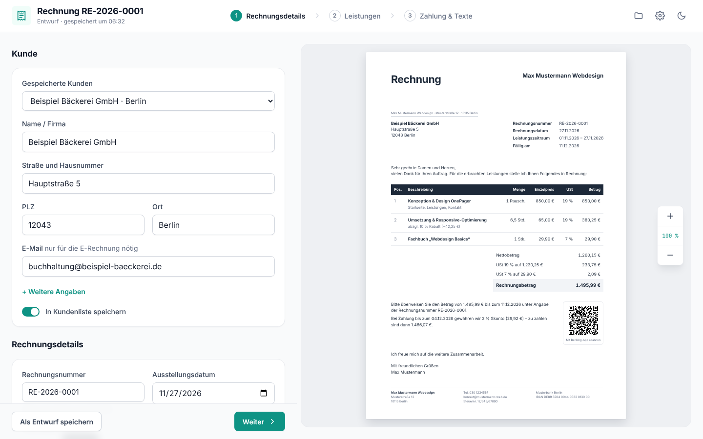

# 🧾 Rechnungsgenerator

[](https://github.com/Surhay276/rechnungs-generator/actions/workflows/ci.yml)


Rechnungen direkt im Browser erstellen: Schritt für Schritt, mit Live-Vorschau, PDF/A mit eingebetteter E-Rechnung (ZUGFeRD), XRechnung und GiroCode. Alle Daten bleiben lokal, es gibt keinen eigenen Server.

**▶ Live-Demo: [surhay276.github.io/rechnungs-generator](https://surhay276.github.io/rechnungs-generator/)**



<p>
  
  
</p>

## Funktionen

**Rechnung erstellen**
- Startet leer: ein Hinweis führt zu den **eigenen Firmendaten** (Einstellungen); ein ausgefülltes Beispiel gibt es per Klick unter *Einstellungen → Beispieldaten ansehen*
- Geführter Ablauf in **drei Schritten** (Rechnungsdetails → Leistungen → Zahlung & Texte), Aufbau angelehnt an Qonto
- **Kundenliste**: Kunden speichern und mit einem Klick übernehmen
- **Adressvorschläge beim Tippen**: Straße eingeben → Vorschlag mit Hausnummer, PLZ und Ort wählen; zur PLZ wird der Ort ergänzt und ein unpassender Ort gemeldet (abschaltbar). Nur Straßen, die mit der Eingabe beginnen; sortiert nach Nähe: zum eigenen Firmensitz oder, **nur mit Einwilligung**, zum aktuellen Standort (auf ca. 1 km gerundet, nie gespeichert, jederzeit widerrufbar)
- **Dokumentarten:** Rechnung, **Abschlagsrechnung**, **Schlussrechnung** (Abschläge mit enthaltener USt werden abgezogen, § 14 Abs. 5 UStG) und **Stornorechnung** mit Verweis auf das Original
- **Zahlungsfrist** per Auswahl (sofort, 7/14/30/45/60 Tage oder eigenes Datum); **Leistungsdatum** ausdrücklich wählbar: wie Rechnungsdatum, eigener Tag oder Zeitraum
- Leistungen mit Einheit, **Netto- oder Bruttopreisen** (der eingegebene Bruttobetrag bleibt auf den Cent der Rechnungsbetrag) und **Rabatt** je Position; Einzelpreise mit bis zu 4 Nachkommastellen
- **Steuerarten je Position:** 19 %, 7 %, steuerfrei nach § 4 (mit Befreiungsgrund), **Reverse-Charge** (§ 13b), **innergemeinschaftliche Lieferung**, **Ausfuhr**, **Differenzbesteuerung** (§ 25a) und Nullsteuersatz, jeweils mit dem Pflichthinweis auf der Rechnung
- Kunden im **Ausland** (Land, USt-IdNr. des Kunden), **Fremdwährung** mit Umsatzsteuer in Euro
- **Rabatt auf den Gesamtbetrag** in Euro oder Prozent, **Skonto**, **Kleinunternehmerregelung** (§ 19 UStG), Hinweis auf die **Aufbewahrungspflicht** (§ 14b UStG)
- **Rechtsform & Handelsregister** (GmbH, UG, AG, KG, e. K. …) mit Registergericht, -nummer und Geschäftsführung in der Fußzeile
- **Nummernkreis frei wählbar** (z. B. `RE-{JJJJ}-{NR}`), numerisch fortgezählt und auf Eindeutigkeit geprüft
- Kopfzeile und Anmerkungen als Vorlage für neue Rechnungen speichern

**Prüfen & Exportieren**
- **Pflichtangaben-Prüfung** nach § 14 Abs. 4 und § 14a UStG: fehlende Angaben werden direkt am Feld markiert, der Export springt dorthin. Fehler blockieren, **Warnungen** (z. B. Datum in der Zukunft, Nummernfolge passt nicht zum Datum) nur Hinweise
- **Kennungen mit Prüfziffer:** IBAN, deutsche USt-IdNr. (ISO 7064), Leitweg-ID (MOD 97-10), USt-IdNr.-Formate aller EU-Länder, Steuernummer (10, 11 oder 13 Ziffern)
- **Plausibilitätsprüfung**: „a“ oder „Test“ fallen auf, Straße braucht eine Hausnummer, PLZ fünf Ziffern. Echte Namen wie „BMW AG“, „O2“, „Coco“ oder „Yılmaz“ bleiben erlaubt
- **GiroCode** (EPC-QR) auf der Rechnung: Kunden scannen ihn mit dem Smartphone und zahlen ohne Abtippen
- **PDF-Export direkt im Programm** als **PDF/A-3b mit eingebetteter E-Rechnung (ZUGFeRD 2 / Factur-X, Profil EN 16931)**. Erfüllt die E-Rechnungspflicht ab 2027/2028 und ist zugleich lesbar. Echte Vektorschrift, A4 nach DIN 5008, Folgeseiten mit wiederholtem Tabellenkopf
- **E-Rechnung im Format XRechnung 3.0** (EN 16931, Syntax CII), z. B. für Behörden mit Leitweg-ID

**Verwalten**
- **Festschreibung:** Beim ersten Export wird die Rechnung nach einer Bestätigung abgeschlossen. Danach ist sie nicht mehr änderbar oder löschbar. Firmendaten, Steuerstatus und Design werden eingefroren; Korrekturen laufen über eine **Stornorechnung**
- **Originale:** PDF und E-Rechnung werden beim Abschließen genau einmal erzeugt und mit SHA-256-Prüfsumme abgelegt (IndexedDB). Spätere Downloads liefern byte-genau das verschickte Dokument, auch nach Programm-Updates
- **Sicherung** als JSON-Datei (inklusive Originale) herunterladen und wieder einspielen; „Daten löschen“ und das Einspielen einer Sicherung lassen abgeschlossene Rechnungen immer unangetastet
- **Rechnungsarchiv** mit Status (Entwurf/Abgeschlossen/Storniert), Duplizieren, Stornieren und Löschen von Entwürfen mit Rückgängig
- **Einstellungen** für Firmendaten, Bankverbindung und **Logo-Upload**
- **Rechnungsdesign:** Farbe per Farbfeld, Farbrad oder Hex-Code, Tabellenkopf gefüllt oder hell. Die Schriftfarbe wird nach WCAG-Kontrast automatisch angepasst, damit auch helle Farben lesbar bleiben
- Vorschau am Desktop als **ganze Seite** mit Zoom (+/−, Strg/⌘ + Mausrad, Touchpad)
- **Heller Standard-Modus und Dark Mode**, mobil optimiert bis 280 px Breite

## Entscheidungen

**Warum ohne Framework?** Die App ist klein genug, um sie mit reinem JavaScript sauber zu strukturieren. Kein Build-Schritt, keine Abhängigkeiten, die veralten, und jede Zeile ist nachvollziehbar. Die Trennung von Logik und Oberfläche übernimmt die Rolle, die sonst ein Framework spielt.

**Warum Geldbeträge in Cent und Eingaben als Text?** In JavaScript ist `0.1 + 0.2 !== 0.3`, und selbst `Number('1.005') * 100` ergibt 100,49999… Die App zerlegt Eingaben deshalb als Text und rechnet mit ganzen Zahlen (Cent, Preise und Mengen in Zehntausendsteln, Produkte als `BigInt`). Gerundet wird kaufmännisch, halbe Werte vom Nullpunkt weg. Deutsches Zahlenformat hat Vorrang: „1.500“ sind eintausendfünfhundert Euro, nicht 1,50 €.

**Wie bleiben Bruttopreise auf den Cent genau?** Wer 99,99 € brutto eingibt, erwartet 99,99 € auf der Rechnung. Die E-Rechnung verlangt aber Steuer = Netto × Satz (Regel BR-CO-17). Die App sucht deshalb den Nettobetrag, bei dem beides aufgeht; nur wo das rechnerisch unmöglich ist (etwa 99,99 € zu 19 %), gleicht ein ausgewiesener Rundungsbetrag von 1 Cent (BT-114) aus.

**Warum Steuer je Steuersatz statt je Zeile?** Wird die Umsatzsteuer je Position gerundet, weicht die Summe schnell um Cents ab. Die App berechnet sie auf die Summe je Steuersatz, so wie es auch die Rechenregeln der E-Rechnung (EN 16931) vorsehen.

**Wie wird ein Gesamtrabatt bei mehreren Steuersätzen verteilt?** Anteilig nach dem Verfahren der größten Reste. So mindert der Rabatt jede Steuerbasis korrekt und die Summe stimmt trotzdem auf den Cent.

**Warum strukturierte Adressen?** Für die E-Rechnung müssen Straße, PLZ und Ort einzeln vorliegen. Freitext-Adressen hätten zu ungültigen Dateien geführt.

**Warum lassen sich abgeschlossene Rechnungen nicht mehr ändern?** Nach den GoBD müssen ausgestellte Rechnungen unveränderbar aufbewahrt werden. Es reicht nicht, nur die Eingabefelder zu sperren: Würden Firmendaten aus den aktuellen Einstellungen gelesen, könnte eine spätere Adressänderung alte Rechnungen nachträglich verfälschen. Deshalb speichert die App beim Abschließen eine eingefrorene Kopie dieser Angaben direkt an der Rechnung (getestet in `tests/invoice.test.js`).

**Warum CII statt UBL?** ZUGFeRD bettet die E-Rechnung in der Syntax CII ins PDF ein. Mit CII auch für die XRechnung gibt es eine einzige Quelle für beide Formate: dieselben Daten, dieselben Regeln, nur eine andere Kennung.

**Warum Originale statt Neuberechnung?** Nach GoBD muss das versendete Dokument unverändert aufbewahrt werden. Würde die App ein altes PDF bei jedem Download neu berechnen, könnte ein späteres Programm-Update das Ergebnis verändern. Deshalb wird beim Abschließen jedes Dokument genau einmal erzeugt und mit Prüfsumme abgelegt.

**Was hat die offizielle Prüfung gezeigt?** Der KoSIT-Validator hat anfangs drei von vier Beispiel-Rechnungen abgelehnt: Regel BR-CO-26 verlangt eine Verkäuferkennung, eine reine Steuernummer reicht dafür nicht. Ohne USt-IdNr. (z. B. als Kleinunternehmer) übermittelt die App die Steuernummer deshalb zusätzlich als Verkäuferkennung (BT-29). Seitdem werden alle Varianten angenommen.

**Warum ein eigener PDF-Generator statt Druckdialog oder Bibliothek?** Über `window.print()` hängt das Ergebnis vom Browser ab (Ränder, Kopf-/Fußzeilen, Dateiname), und der Nutzer muss sich durch den Druckdialog klicken. Bibliotheken wie jsPDF + html2canvas machen aus der Seite ein Bild, unscharf und ohne kopierbaren Text. `js/pdf.js` schreibt das PDF selbst (~300 Zeilen): Inter wird als TrueType-Teilmenge eingebettet (`Identity-H` + `ToUnicode`, damit auch ş, ğ, ı funktionieren und Text kopierbar bleibt), Streams werden mit der eingebauten `CompressionStream` komprimiert. Vorschau und PDF bauen auf demselben Datenmodell (`js/view.js`) auf. So kann nichts auseinanderlaufen.

**Wie erkennt die App Quatsch-Eingaben, ohne echte Namen auszusperren?** Statt einer Liste erlaubter Namen prüft sie typische Fehlermuster: zu wenige Buchstaben, Platzhalter („Test“, „asdf“), Tastaturreihen, vier gleiche Buchstaben in Folge (drei gibt es: „Schifffahrt“), sich wiederholende Silben und lange Wörter ohne Vokal („hjkgfd“). Kurze Abkürzungen wie „BMW“ oder „KPMG“ bleiben erlaubt. Die Unit-Tests halten beide Seiten fest.

**Warum keine Daten auf einem Server?** Rechnungsdaten sind sensibel. Alles bleibt im `localStorage` des Browsers, Schriften und die QR-Bibliothek werden lokal ausgeliefert. Rechnungsdaten gehen nie an Dritte. Die einzige Ausnahme ist bewusst klein gehalten und abschaltbar: Für Adressvorschläge wird nur der gerade getippte Adresstext abgefragt.

## Technische Umsetzung

| Bereich | Umsetzung |
|---|---|
| Architektur | Rechenlogik (`js/invoice.js`) ohne DOM, vollständig getestet; Oberfläche in `js/app.js` |
| E-Rechnung | XRechnung 3.0 und ZUGFeRD/Factur-X (EN 16931) in der Syntax CII; bei jedem Push prüft die CI **18 Sonderfälle** (Reverse-Charge, EU-Lieferung, Ausfuhr, § 4, § 25a, Bruttopreise mit Rundung, Storno, Abschlag, Schlussrechnung, Fremdwährung …) mit dem **offiziellen KoSIT-Validator** |
| PDF/A | Eigener PDF-Schreiber erzeugt PDF/A-3b (XMP-Metadaten, sRGB-Profil, eingebettete XML als „Associated File“); die CI prüft alle 18 ZUGFeRD-PDFs mit **veraPDF** |
| GiroCode | Inhalt nach EPC069-12 (Version 002, UTF-8); QR-Code über [qrcode-generator](js/vendor/README.md) (MIT), lokal eingebunden |
| Sicherheit & Datenschutz | Strenge Content-Security-Policy (keine Inline-Skripte), Ausgabe nur über `textContent`, XML-Werte werden escaped und von Steuerzeichen bereinigt. Einzige externe Anfragen: Adressvorschläge (nur der getippte Adresstext geht an [Photon](https://photon.komoot.io) (OpenStreetMap) und die [OpenPLZ API](https://www.openplzapi.org)) und Wechselkurse (nur Währung und Datum an die [Frankfurter API](https://frankfurter.dev), EZB-Referenzkurse); in den Einstellungen abschaltbar. Standort nur nach Einwilligungsdialog + Browser-Freigabe (Art. 6 Abs. 1 lit. a DSGVO, § 25 TDDDG), gerundet und nur im Arbeitsspeicher |
| PDF | Eigener PDF-Schreiber (`js/pdf.js`) + Layout (`js/invoice-pdf.js`); Inter als eingebettete Teilmenge (`fonts/inter-pdf-*.ttf`, erzeugt mit `scripts/build-pdf-fonts.py`) |
| Tests | 72 Unit-Tests mit `node:test`: Zahlenformat und Rundung, Bruttopreise (alle Beträge bis 50 €), Rabattverteilung, Steuerarten, Skonto, Nummernkreis, Prüfziffern, Pflichtangaben, XML-Summen, PDF/A-Aufbau, Storno |
| Barrierefreiheit | Geprüft mit axe-core ohne Befunde (hell & dunkel, Desktop & Handy): Kontraste nach WCAG AA, Touch-Ziele ≥ 44 px, beschriftete Felder, Fehler per `aria-invalid`/`aria-describedby`, sichtbarer Fokus, `prefers-reduced-motion` |
| CI/CD | GitHub Actions: Unit-Tests + E-Rechnungs-Prüfung (Validator per Prüfsumme gesichert), Deployment über GitHub Pages |
| Aktualität | Die Seite fragt beim Öffnen `version.json` am Cache vorbei ab und lädt sich bei einer neueren Version einmal frisch. So sieht niemand eine veraltete Version (`node scripts/bump-version.mjs` zählt alle Versionsangaben hoch) |

```
rechnungs-generator/
├── index.html                      # Aufbau: Schritte, Vorschau, Seitenfenster
├── css/style.css                   # Tokens (hell/dunkel), Layout, Druck-Layout
├── assets/sRGB.icc                 # Farbprofil für PDF/A (gemeinfrei)
├── js/
│   ├── invoice.js                  # bündelt die Fachlogik (ohne DOM, vollständig getestet):
│   ├── money.js                    #   Zahlen einlesen, centgenau runden, formatieren
│   ├── tax.js                      #   Steuerarten, Länder, Währungen, Dokumentarten, Rechtsformen
│   ├── calc.js                     #   Positionen, Rabatte, Steuer-Aufstellung, Brutto/Netto, Skonto
│   ├── dates.js                    #   Datum, Fälligkeit, Leistungsdatum
│   ├── numbering.js                #   Nummernkreis
│   ├── checks.js · validate.js     #   Einzelprüfungen · Pflichtangaben (Fehler und Warnungen)
│   ├── einvoice.js                 #   E-Rechnung CII (XRechnung + ZUGFeRD)
│   ├── girocode.js · lock.js       #   GiroCode · Festschreibung, Storno
│   ├── view.js                     # Rechnungsinhalt als Datenmodell: Grundlage für Vorschau und PDF
│   ├── pdf.js · invoice-pdf.js     # PDF/A-3-Schreiber · Layout der Rechnung
│   ├── app.js                      # Hauptansicht: Formular, Schritte, Prüfmeldungen, Export
│   ├── store.js · originals.js     # Speicherstand (localStorage) · Originale (IndexedDB)
│   ├── export.js · preview.js      # Dokumente erzeugen, Sicherung · Vorschau und Zoom
│   ├── settings-panel.js · archive-panel.js
│   ├── ui.js · boot.js · color.js · address.js
│   └── vendor/                     # QR-Bibliothek (MIT)
├── fonts/inter-pdf-*.ttf           # Schriften fürs PDF (Inter, OFL)
├── scripts/                        # Beispieldaten, E-Rechnungs-/ZUGFeRD-Beispiele, Prüfberichte auswerten
└── tests/                          # Unit-Tests
```

## Lokal starten

```bash
git clone https://github.com/Surhay276/rechnungs-generator.git
cd rechnungs-generator
npm start                                   # statischer Server
npm test                                    # Unit-Tests (Node ≥ 20)
node scripts/xrechnung-samples.mjs out/ --pdf   # Beispiel-E-Rechnungen + ZUGFeRD-PDFs erzeugen
```

> Portfolio-Projekt. Ersetzt keine Buchhaltungssoftware oder steuerliche Beratung. Beispieldaten und die Muster-IBAN sind fiktiv. Die E-Rechnungen werden technisch mit dem offiziellen [KoSIT-Validator](https://github.com/itplr-kosit/validator) geprüft; ob eine Rechnung inhaltlich und steuerlich korrekt ist, hängt von den eingegebenen Daten ab.

---

Entwickelt von **Hüseyin Surhay Yilmaz** · Lizenz: MIT
