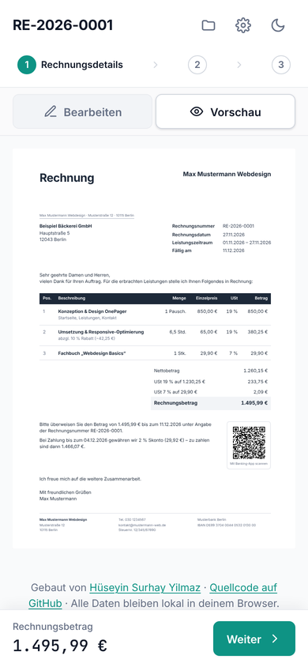
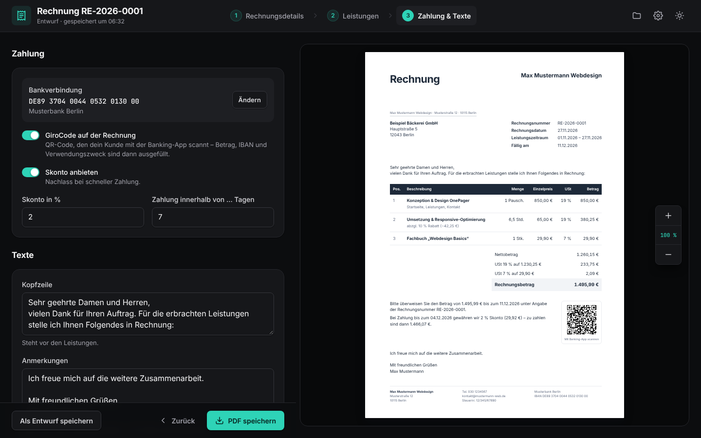

# 🧾 Rechnungsgenerator

[](https://github.com/Surhay276/rechnungs-generator/actions/workflows/ci.yml)


Rechnungen direkt im Browser erstellen – Schritt für Schritt, mit Live-Vorschau, echtem PDF-Export, GiroCode und E-Rechnung. Alle Daten bleiben lokal, es gibt keinen eigenen Server.

**▶ Live-Demo: [surhay276.github.io/rechnungs-generator](https://surhay276.github.io/rechnungs-generator/)**


<p>
  
  
</p>

## Funktionen

**Rechnung erstellen**
- Startet leer: ein Hinweis führt zu den **eigenen Firmendaten** (Einstellungen); ein ausgefülltes Beispiel gibt es per Klick unter *Einstellungen → Beispieldaten ansehen*
- Geführter Ablauf in **drei Schritten** (Rechnungsdetails → Leistungen → Zahlung & Texte), Aufbau angelehnt an Qonto
- **Kundenliste**: Kunden speichern und mit einem Klick übernehmen
- **Adressvorschläge beim Tippen**: Straße eingeben → Vorschlag mit Hausnummer, PLZ und Ort wählen; zur PLZ wird der Ort ergänzt und ein unpassender Ort gemeldet (abschaltbar). Nur Straßen, die mit der Eingabe beginnen; sortiert nach Nähe – zum eigenen Firmensitz oder, **nur mit Einwilligung**, zum aktuellen Standort (auf ca. 1 km gerundet, nie gespeichert, jederzeit widerrufbar)
- **Zahlungsfrist** per Auswahl (sofort, 7/14/30/45/60 Tage oder eigenes Datum), **Leistungszeitraum** von–bis
- Leistungen mit Einheit, **Netto- oder Bruttopreis** (wird automatisch umgerechnet) und **Rabatt** je Position
- **Rabatt auf den Gesamtbetrag** in Euro oder Prozent
- **Skonto** bei schneller Zahlung, **Kleinunternehmerregelung** (§ 19 UStG)
- Kopfzeile und Anmerkungen als Vorlage für neue Rechnungen speichern

**Prüfen & Exportieren**
- **Pflichtfeld-Prüfung** nach § 14 UStG: fehlende Angaben werden direkt am Feld markiert, der Export springt dorthin
- **Plausibilitätsprüfung**: „a“, „asdf“, „qwertz“ oder „Test“ gehen als Name nicht durch; Straße braucht eine Hausnummer, PLZ fünf Ziffern, Ort keine Ziffern; dazu E-Mail, Telefon, Steuernummer, USt-IdNr. und BIC – echte Namen wie „BMW AG“ oder „Yılmaz“ bleiben erlaubt
- **GiroCode** (EPC-QR) auf der Rechnung – Kunden scannen ihn mit dem Smartphone und zahlen ohne Abtippen
- **PDF-Export direkt im Programm** – ein Klick, das PDF wird gespeichert und sofort geöffnet (kein Druckdialog). Echte Vektorschrift (Text durchsuch- und kopierbar), A4 mit Rändern nach DIN 5008, Logo in Originalproportionen, Folgeseiten mit wiederholtem Tabellenkopf und Seitenzahlen
- **E-Rechnung im Format XRechnung 3.0** (XML nach EN 16931, Syntax UBL)

**Verwalten**
- **Festschreibung nach GoBD:** Beim ersten Export wird die Rechnung nach einer Bestätigung abgeschlossen – danach ist sie nicht mehr änderbar oder löschbar. Firmendaten, Steuerstatus und Design werden dabei eingefroren; Korrekturen laufen über eine Kopie mit neuer Nummer
- **Rechnungsarchiv** mit Status (Entwurf/Abgeschlossen), Duplizieren und Löschen von Entwürfen mit Rückgängig; abgeschlossene Rechnungen jederzeit erneut als **PDF oder E-Rechnung herunterladen**
- **Einstellungen** für Firmendaten, Bankverbindung und **Logo-Upload**
- **Rechnungsdesign:** Farbe per Farbfeld, Farbrad oder Hex-Code, Tabellenkopf gefüllt oder hell – die Schriftfarbe wird nach WCAG-Kontrast automatisch angepasst, damit auch helle Farben lesbar bleiben
- Vorschau am Desktop als **ganze Seite** mit Zoom (+/−, Strg/⌘ + Mausrad, Touchpad)
- **Heller Standard-Modus und Dark Mode**, mobil optimiert bis 280 px Breite

## Entscheidungen

**Warum ohne Framework?** Die App ist klein genug, um sie mit reinem JavaScript sauber zu strukturieren. Kein Build-Schritt, keine Abhängigkeiten, die veralten – und jede Zeile ist nachvollziehbar. Die Trennung von Logik und Oberfläche übernimmt die Rolle, die sonst ein Framework spielt.

**Warum Geldbeträge in Cent?** In JavaScript ist `0.1 + 0.2 !== 0.3`. Rechnungen müssen auf den Cent stimmen, deshalb rechnet die App intern nur mit ganzen Cent-Beträgen und formatiert erst bei der Ausgabe.

**Warum Steuer je Steuersatz statt je Zeile?** Wird die Umsatzsteuer je Position gerundet, weicht die Summe schnell um Cents ab. Die App berechnet sie auf die Summe je Steuersatz – so, wie es auch die Rechenregeln der E-Rechnung (EN 16931) vorsehen.

**Wie wird ein Gesamtrabatt bei mehreren Steuersätzen verteilt?** Anteilig nach dem Verfahren der größten Reste. So mindert der Rabatt jede Steuerbasis korrekt und die Summe stimmt trotzdem auf den Cent.

**Warum strukturierte Adressen?** Für die E-Rechnung müssen Straße, PLZ und Ort einzeln vorliegen. Freitext-Adressen hätten zu ungültigen Dateien geführt.

**Warum lassen sich abgeschlossene Rechnungen nicht mehr ändern?** Nach den GoBD müssen ausgestellte Rechnungen unveränderbar aufbewahrt werden. Es reicht nicht, nur die Eingabefelder zu sperren: Würden Firmendaten aus den aktuellen Einstellungen gelesen, könnte eine spätere Adressänderung alte Rechnungen nachträglich verfälschen. Deshalb speichert die App beim Abschließen eine eingefrorene Kopie dieser Angaben direkt an der Rechnung (getestet in `tests/invoice.test.js`).

**Was hat die offizielle Prüfung gezeigt?** Der KoSIT-Validator hat anfangs drei von vier Beispiel-Rechnungen abgelehnt: Regel BR-CO-26 verlangt eine Verkäuferkennung – eine reine Steuernummer reicht dafür nicht. Ohne USt-IdNr. (z. B. als Kleinunternehmer) übermittelt die App die Steuernummer deshalb zusätzlich als Verkäuferkennung (BT-29). Seitdem werden alle Varianten angenommen.

**Warum ein eigener PDF-Generator statt Druckdialog oder Bibliothek?** Über `window.print()` hängt das Ergebnis vom Browser ab (Ränder, Kopf-/Fußzeilen, Dateiname), und der Nutzer muss sich durch den Druckdialog klicken. Bibliotheken wie jsPDF + html2canvas machen aus der Seite ein Bild – unscharf und ohne kopierbaren Text. `js/pdf.js` schreibt das PDF selbst (~300 Zeilen): Inter wird als TrueType-Teilmenge eingebettet (`Identity-H` + `ToUnicode`, damit auch ş, ğ, ı funktionieren und Text kopierbar bleibt), Streams werden mit der eingebauten `CompressionStream` komprimiert. Vorschau und PDF bauen auf demselben Datenmodell (`js/view.js`) auf – so kann nichts auseinanderlaufen.

**Wie erkennt die App Quatsch-Eingaben, ohne echte Namen auszusperren?** Statt einer Liste erlaubter Namen prüft sie typische Fehlermuster: zu wenige Buchstaben, Platzhalter („Test“, „asdf“), Tastaturreihen, vier gleiche Buchstaben in Folge (drei gibt es: „Schifffahrt“), sich wiederholende Silben und lange Wörter ohne Vokal („hjkgfd“) – kurze Abkürzungen wie „BMW“ oder „KPMG“ bleiben erlaubt. Die Unit-Tests halten beide Seiten fest.

**Warum keine Daten auf einem Server?** Rechnungsdaten sind sensibel. Alles bleibt im `localStorage` des Browsers, Schriften und die QR-Bibliothek werden lokal ausgeliefert – Rechnungsdaten gehen nie an Dritte. Die einzige Ausnahme ist bewusst klein gehalten und abschaltbar: Für Adressvorschläge wird nur der gerade getippte Adresstext abgefragt.

## Technische Umsetzung

| Bereich | Umsetzung |
|---|---|
| Architektur | Rechenlogik (`js/invoice.js`) ohne DOM, vollständig getestet; Oberfläche in `js/app.js` |
| E-Rechnung | XML nach XRechnung 3.0 (UBL 2.1); bei jedem Push prüft die CI vier Beispiel-Rechnungen mit dem **offiziellen KoSIT-Validator** (EN 16931 + deutsche XRechnung-Regeln) |
| GiroCode | Inhalt nach EPC069-12 (Version 002, UTF-8); QR-Code über [qrcode-generator](js/vendor/README.md) (MIT), lokal eingebunden |
| Sicherheit & Datenschutz | Ausgabe nur über `textContent`, XML-Werte werden escaped. Einzige externe Anfragen: Adressvorschläge – nur der getippte Adresstext geht an [Photon](https://photon.komoot.io) (OpenStreetMap) und die [OpenPLZ API](https://www.openplzapi.org); in den Einstellungen abschaltbar. Standort nur nach Einwilligungsdialog + Browser-Freigabe (Art. 6 Abs. 1 lit. a DSGVO, § 25 TDDDG), gerundet und nur im Arbeitsspeicher |
| PDF | Eigener PDF-Schreiber (`js/pdf.js`) + Layout (`js/invoice-pdf.js`); Inter als eingebettete Teilmenge (`fonts/inter-pdf-*.ttf`, erzeugt mit `scripts/build-pdf-fonts.py`) |
| Tests | Unit-Tests mit `node:test` – Rundung, Rabattverteilung, Skonto, IBAN, GiroCode, Pflichtangaben, Plausibilität, XML-Summen, PDF-Aufbau und -Text (inkl. Sonderzeichen und Folgeseiten) |
| Barrierefreiheit | Geprüft mit axe-core ohne Befunde (hell & dunkel, Desktop & Handy): Kontraste nach WCAG AA, Touch-Ziele ≥ 44 px, beschriftete Felder, Fehler per `aria-invalid`/`aria-describedby`, sichtbarer Fokus, `prefers-reduced-motion` |
| CI/CD | GitHub Actions: Unit-Tests + E-Rechnungs-Prüfung (Validator per Prüfsumme gesichert), Deployment über GitHub Pages |
| Aktualität | Die Seite fragt beim Öffnen `version.json` am Cache vorbei ab und lädt sich bei einer neueren Version einmal frisch – so sieht niemand eine veraltete Version (`node scripts/bump-version.mjs` zählt alle Versionsangaben hoch) |

```
rechnungs-generator/
├── index.html                     # Aufbau: Schritte, Vorschau, Seitenfenster
├── css/style.css                  # Tokens (hell/dunkel), Layout, Druck-Layout
├── js/color.js                  # Farbtöne und Kontrast fürs Rechnungsdesign (getestet)
├── js/invoice.js                  # Logik: Cent-Arithmetik, USt, Rabatte, Skonto, GiroCode, XRechnung
├── js/view.js                     # Rechnungsinhalt als Datenmodell – Grundlage für Vorschau und PDF
├── js/pdf.js                      # PDF-Schreiber: Schriften einbetten, Text, Linien, Bilder
├── js/invoice-pdf.js              # Layout der Rechnung im PDF (Seitenumbruch, Fußzeile)
├── js/address.js                  # Adressvorschläge (Photon/OpenStreetMap, OpenPLZ)
├── js/app.js                      # Oberfläche, Speicherung, Vorschau, Export
├── fonts/inter-pdf-*.ttf          # Schriften fürs PDF (Inter, OFL)
├── js/vendor/                     # QR-Bibliothek (MIT)
├── scripts/samples.mjs            # Beispieldaten für Demo und Tests
├── scripts/xrechnung-samples.mjs  # erzeugt Beispiel-E-Rechnungen
├── scripts/check-kosit-reports.mjs # wertet die Berichte des KoSIT-Validators aus
├── scripts/build-pdf-fonts.py     # erzeugt die PDF-Schriften aus Inter
└── tests/                         # Unit-Tests
```

## Lokal starten

```bash
git clone https://github.com/Surhay276/rechnungs-generator.git
cd rechnungs-generator
npm start                                   # statischer Server
npm test                                    # Unit-Tests (Node ≥ 20)
node scripts/xrechnung-samples.mjs out/     # Beispiel-E-Rechnungen erzeugen
```

> Portfolio-Projekt – ersetzt keine Buchhaltungssoftware oder steuerliche Beratung. Beispieldaten und die Muster-IBAN sind fiktiv. Die E-Rechnungen werden technisch mit dem offiziellen [KoSIT-Validator](https://github.com/itplr-kosit/validator) geprüft; ob eine Rechnung inhaltlich und steuerlich korrekt ist, hängt von den eingegebenen Daten ab.

---

Entwickelt von **Hüseyin Surhay Yilmaz** · Lizenz: MIT
